<!-- transition: swipe -->
<!-- theme: green_black -->

<h1 class="center">発表スライド作ってみた</h1>

---

<!-- transition: swipe -->

# こんにちは 天城です

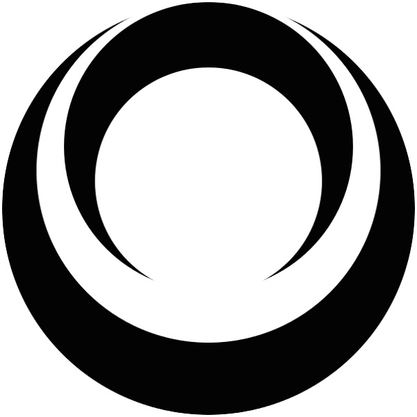

- Twitter: @amagitakayosi
- GitHub: @fand
- Kyoto.js運営
- 最近はRust書いてます

---

# 過去作: VEDA

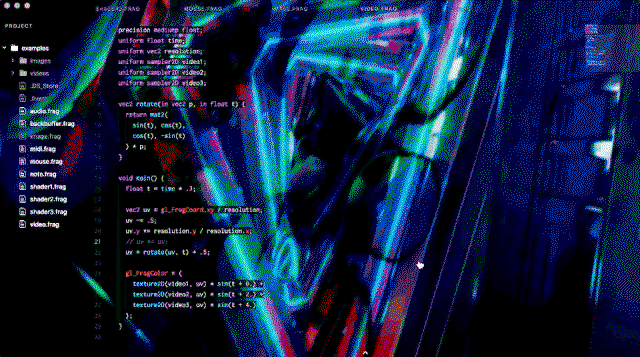

Atom上でWebGLライブコーディングができるプラグイン

---

<!-- transition: datamosh -->
<!-- duration: 1.5 -->

# 過去作: REACT-VFX

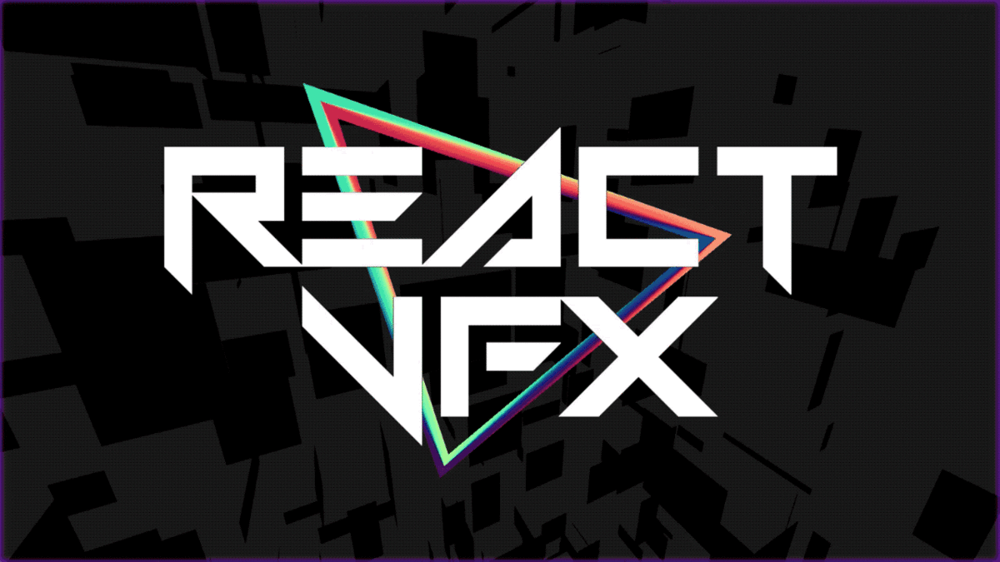

Reactアプリ内で画像や動画に映像エフェクトをかけるライブラリ

---

# 過去作: jovi-jovi

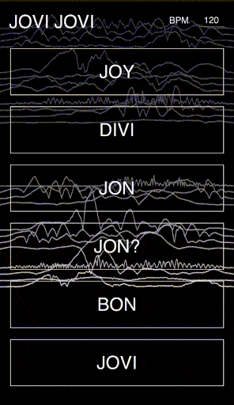

Webアプリ
(Rustの練習で作った)

---

<!-- transition: swipe -->
<!-- theme: yellow_black -->

<h1 class="center">前回のKyoto.js</h1>

---

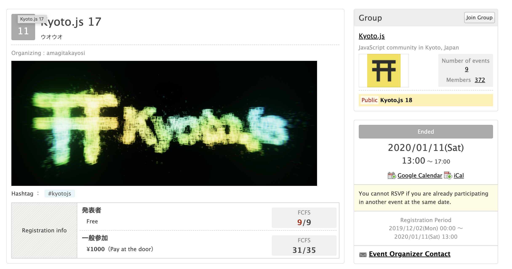

---

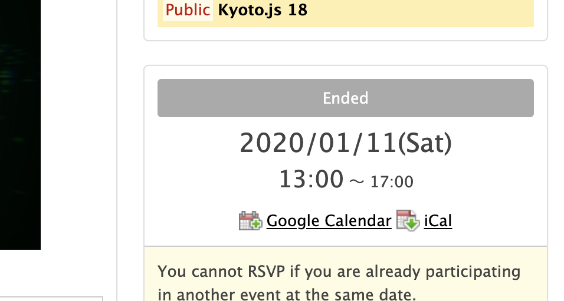

---

<!-- theme: red_white -->

<h3 class="center">
スライドの作り方<br/>
忘れちゃった……
</h3>

---

<!-- transition: zoom_blur -->
<!-- duration: 2 -->

<h3 class="center"> ので、</h3>

---

<!-- theme: black_red -->
<!-- transition: glitch -->
<!-- duration: 2 -->

<h1 class="center">スライドショー用アプリを</br>作りました</h1>

---

<!-- theme: yellow_black -->
<!-- transition: zoom -->
<!-- duration: 2 -->

<h1 class="center">スライドショー用アプリを</br>作りました</h1>

---

<!-- theme: red_white -->

<h1 class="center">スライドショー用アプリを</br>作りました</h1>

---

<!-- transition: swipe -->

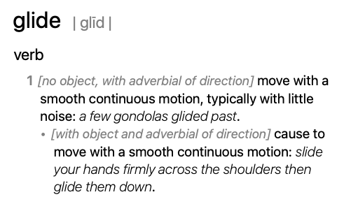

---

# 構成

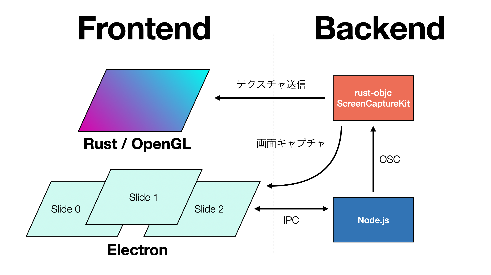

あとで解説します

---

# スライドショーアプリの要件

- MUST
  - Markdownで書きたい
  - 画像を表示したい
- SHOULD
  - トランジション
- MAY
  - 動画対応

---

# Markdownを描画したい

- パースしてASTで処理するのはなんとでもなる
- HTML/JSで描画しない場合、画像/動画の処理が大変
  - フレームを取り出してテクスチャを更新して……という処理が必要になる

---

# トランジション

- ページ遷移時のアニメーション
- GLにページの内容を渡す必要がある
  - HTMLの描画結果を取得するのは難しい

本スライドでは、WebGL, OpenGLなどのグラフィック系APIをまとめて `GL` と呼びます

---

# HTMLの描画結果を取得するのは難しい

- html2canvasというのもあるが……
  - まあまあ重い
  - まれにレイアウトがおかしくなる
- html2canvasの仕組み
  - DOM要素からSVGを作り出す
  - REACT-VFXでは、文字列をWebGLに渡すために
    似たような仕組みを使ってました

今回は不採用🙅‍♂️

---

<!-- theme: black_white -->

# 参考: HTML -> SVG変換

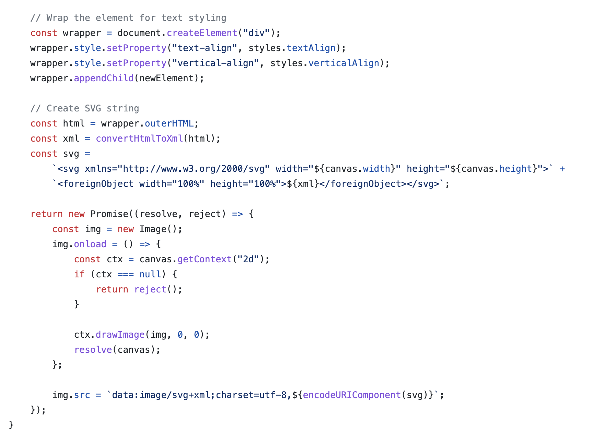

---

## 案1: MarkdownをCanvasで描画する

- HTMLCanvasElementはWebGLテクスチャのソースとして渡せる
  - CanvasでMarkdownを描画すれば、WebGLでいじり放題になる
- pros: 頑張ればできる
- cons: レイアウト処理が大変
- cons: ネイティブで動かすのが難しい
  - Electronの場合、UInt8Arrayでmainプロセスに渡すことは可能
    （仕事でやったことがある）

---

<!-- transition: pixelsort -->
<!-- duration: 1.2 -->

## 案2: MarkdownをGLで描画する

- GL系ライブラリには、テキスト描画できるものもある
- 最初からGLを使ってスライドをテクスチャに書き出してしまうのはどうか？

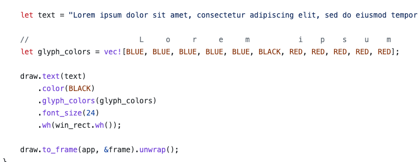

- pros: GL系の処理だけで完結する
- cons: テキストの描画がもっと大変
  - フォントアセットを作る必要があったりする

---

<!-- theme: black_white -->

## 案3: MarkdownをJSで描画して、スクリーンキャプチャをする

ElectronやTauriでキャプチャしてしまったらなんとでもなるのでは？

- pros: Webで表示できるものなら何でも表示できる
- pros: Markdown描画が一瞬で終わる
- cons: なんというか……アホっぽい……

---

<!-- theme: red_white -->

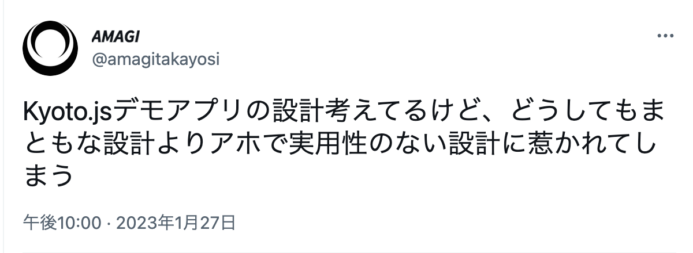

---

# Electronをキャプチャ

- Electronの `BrowserWindow.capturePage` でウインドウをキャプチャして画像ファイルに書き出す
- その後、GL側でテクスチャをリロードする
- 最初はTauriを使っていたけど、ハマりどころが多いので断念した
  - ローカルのファイルをfetchするだけで色々設定する必要があったり
  - capturePageがないので、macosの `screencapture` コマンドを使ったり

---

<!-- theme: green_black -->

# グラフィックス処理

-  RustのGLライブラリは、ネイティブ/wasm両対応のものが色々ある
  - wgpu
  - nannou
  - three-d
  - notan

---

<!-- theme: green_black -->

# Rust GLライブラリ比較

## wgpu
- WebGPUのラッパー
- ネイティブでもwasmでも動く
- ローレベル
  - Vulkan等を直接触るのに比べると楽だけど、それでも行数がおおい

## nannou
- Processing / openFrameworksっぽいAPI
- 作品を作るには便利
- wgpuのAPIを直接触る必要がある

## three-d
- Three.jsっぽいAPI
  - カメラ、マテリアルなどの概念が存在する
- 細かいウインドウ制御ができない

## notan
- JSでいうとreglに近いAPI
- とにかく短くグラフィックスパイプラインを作れる
- バックエンドはglowという別のライブラリを使っている (wgpuと同じ)

---

# 今回はnotanを採用

```rust
use notan::prelude::*;

//language=glsl
const VERT: ShaderSource = notan::vertex_shader! {
    r#"
    #version 450
    layout(location = 0) in vec2 a_pos;
    layout(location = 1) in vec3 a_color;

    layout(location = 0) out vec3 v_color;

    void main() {
        v_color = a_color;
        gl_Position = vec4(a_pos - 0.5, 0.0, 1.0);
    }
    "#
};

//language=glsl
const FRAG: ShaderSource = notan::fragment_shader! {
    r#"
    #version 450
    precision mediump float;

    layout(location = 0) in vec3 v_color;
    layout(location = 0) out vec4 color;

    void main() {
        color = vec4(v_color, 1.0);
    }
    "#
};

#[derive(AppState)]
struct State {
    clear_options: ClearOptions,
    pipeline: Pipeline,
    vbo: Buffer,
}

#[notan_main]
fn main() -> Result<(), String> {
    notan::init_with(setup).draw(draw).build()
}

fn setup(gfx: &mut Graphics) -> State {
    let clear_options = ClearOptions::color(Color::new(0.1, 0.2, 0.3, 1.0));

    let vertex_info = VertexInfo::new()
        .attr(0, VertexFormat::Float32x2)
        .attr(1, VertexFormat::Float32x3);

    let pipeline = gfx
        .create_pipeline()
        .from(&VERT, &FRAG)
        .with_vertex_info(&vertex_info)
        .build()
        .unwrap();

    #[rustfmt::skip]
    let vertices = [
        0.5, 1.0,   1.0, 0.2, 0.3,
        0.0, 0.0,   0.1, 1.0, 0.3,
        1.0, 0.0,   0.1, 0.2, 1.0,
    ];

    let vbo = gfx
        .create_vertex_buffer()
        .with_info(&vertex_info)
        .with_data(&vertices)
        .build()
        .unwrap();

    State {
        clear_options,
        pipeline,
        vbo,
    }
}

fn draw(gfx: &mut Graphics, state: &mut State) {
    let mut renderer = gfx.create_renderer();

    renderer.begin(Some(&state.clear_options));
    renderer.set_pipeline(&state.pipeline);
    renderer.bind_buffer(&state.vbo);
    renderer.draw(0, 3);
    renderer.end();

    gfx.render(&renderer);
}
```

- 実は仕事でも使ってる
- 調査もかねて他のライブラリ使ってみたかったが、一番要件にマッチするのがnotanだった

---

# GLのウインドウを最前面に描画する


```rust
let win = WindowConfig::default()
    .maximized(true)
    .always_on_top(true)
    .mouse_passthrough(true)
    .title("GL!")
    .decorations(false)
    .transparent(true);

notan::init_with(|gfx: &mut Graphics| GLApp::setup(gfx))
    .add_config(win)
    .add_config(DrawConfig)
    .update(Self::update)
    .draw(Self::draw)
    .build()
```

- 最前面に表示して、マウスで触れないようにする
  - 背面にあるElectronのウインドウは操作したいので
- この辺、大体どのGUIライブラリでも一緒ですね

---

<!-- theme: yellow_black -->
<!-- transition: crossfade -->
<!-- duration: 2 -->

<h1 class="center">これで描画はできた、が……</h1>

---

<!-- theme: black_white -->
<!-- transition: crossfade -->
<!-- duration: 2 -->

<div class="center" style="text-align: center;">
  <h2 class="center">おわかりいただけただろうか</h2>
  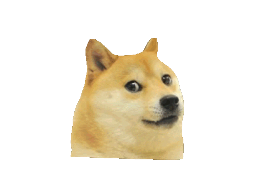
</div>

---

<!-- theme: black_red -->
<!-- transition: zoom_blur -->
<!-- duration: 2 -->

<div class="center" style="text-align: center;">
  <h2 class="center">おわかりいただけただろうか</h2>
  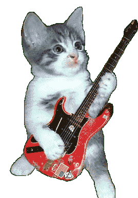
</div>

---

<!-- theme: red_black -->

<h1 class="center">ScreenCaptureKit</h1>

---

# ScreenCaptureKit

- リアルタイムにウインドウの内容をキャプチャするためのmacOSのAPI
- OBS Studioなどで使われている
  - というかAppleがOBSにPull Requestを出して話題になっていた
- Windowsにも `Windows.Graphics.Capture` という似たようなやつがありますね

---

<!-- theme: yellow_black -->

# ScreenCaptureKit、情報少ない……

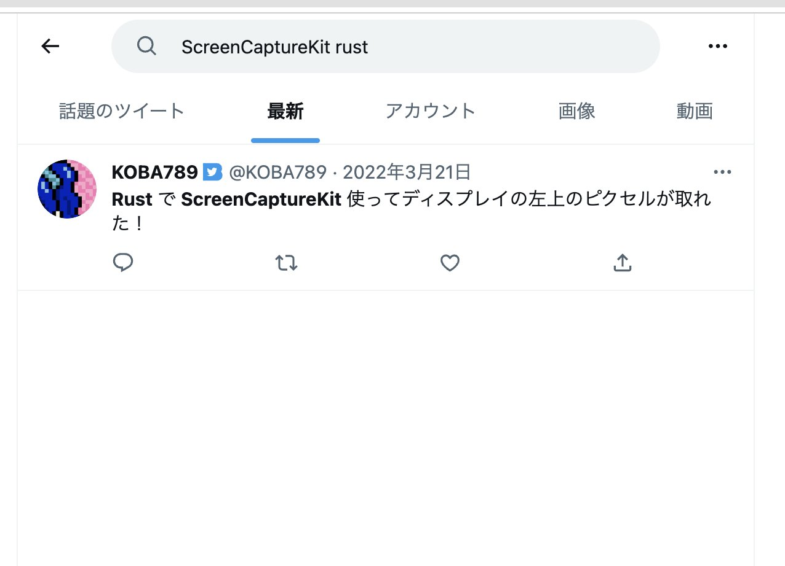

---

# ScreenCaptureKitの参考情報

- Appleの公式ドキュメント
- OBS Studioのコード (`plugins/mac-capture/mac-screen-capture.m`)
  - 当然ObjC++なので何一つわからない
- KOBA789/ScreenCaptureKit2NDI
  - rust-objcを使って、RustからネイティブのAPIを触っている

---

# rust-objc

`msg_send!` でメッセージパッシングができる

```rust
let cls = class!(NSObject);
let obj: *mut Object = msg_send![cls, new];
let hash: usize = msg_send![obj, hash];
let is_kind: BOOL = msg_send![obj, isKindOfClass:cls];
// Even void methods must have their return type annotated
let _: () = msg_send![obj, release];
```


クラスを動的に定義することも可能

```rust
let superclass = class!(NSObject);
let mut decl = ClassDecl::new("MyNumber", superclass).unwrap();

// Add an instance variable
decl.add_ivar::<u32>("_number");

// Add an ObjC method for getting the number
extern fn my_number_get(this: &Object, _cmd: Sel) -> u32 {
    unsafe { *this.get_ivar("_number") }
}
unsafe {
    decl.add_method(sel!(number),
        my_number_get as extern fn(&Object, Sel) -> u32);
}

decl.register();
```

ObjCってそんなことできるんだ……

---

# キャプチャしたデータをRust側に渡して……


```rust
extern "C" fn capture_stream(
    _this: &mut Object,
    _: Sel,
    _stream: id,
    sample_buffer: id,
    _typ: NSInteger,
) {
    let pixel_buffer: id = unsafe { ffi::CMSampleBufferGetImageBuffer(sample_buffer) };
    let pixel_buffer = pixel_buffer as ffi::CVBufferRef;
    let width = unsafe { ffi::CVPixelBufferGetWidth(pixel_buffer) };
    let height = unsafe { ffi::CVPixelBufferGetHeight(pixel_buffer) };

    unsafe {
        ffi::CVPixelBufferLockBaseAddress(pixel_buffer, 1);
        let ptr = ffi::CVPixelBufferGetBaseAddress(pixel_buffer) as *mut u8;
        let delegate_id: u32 = *_this.get_ivar("_delegate_id");

        if width != 0 && height != 0 {
            let slice = std::slice::from_raw_parts(ptr, width * height * 4);
            store::save_buffer(delegate_id, slice, width, height); // ここ
        }

        ffi::CVPixelBufferUnlockBaseAddress(pixel_buffer, 1);
    }
}
decl.add_method(
    sel!(stream:didOutputSampleBuffer:ofType:),
    capture_stream as extern "C" fn(&mut Object, _, id, id, NSInteger),
);
```

---

<!-- theme: black_red -->

# static mut ………………

```rust
static mut MAP: Lazy<HashMap<u32, TexInfo>> = Lazy::new(|| HashMap::new());

pub fn save_buffer(id: u32, buf: &[u8], width: usize, height: usize) {
    unsafe {
        MAP.insert(
            id,
            TexInfo {
                buf: buf.to_vec(),
                width,
                height,
            },
        );
    }
}

pub fn get_buffer(id: u32) -> Option<&'static TexInfo> {
    unsafe { MAP.get(&id) }
}
```

---

# テクスチャに渡す

```rust
if let Some(tex) = store::get_buffer(0) {
    update_texture(gfx, &mut state.texture0, tex, 0);
}
```

---

<!-- theme: yellow_black -->
<!-- transition: zoom_blur -->
<!-- duration: 2 -->

# あとはトランジションのシェーダーを書いてあげれば……

```glsl
vec4 crossfade(vec2 uv, int page1, int page2, float t) {
    return mix(readTex(uv, page1), readTex(uv, page2), t);
}

vec4 swipe(vec2 uv, int page1, int page2, float t) {
    uv.x += t;
    if (uv.x < 1.) {
        return readTex(uv, page1);
    } else {
        return readTex(uv - vec2(1, 0), page2);
    }
}
```

---

<!-- theme: red_white -->

<h1 class="center" style="font-size: 192px;">🎉🎉🎉完成！🎉🎉🎉</h1>

---

<!-- transition: crossfade -->
<!-- duration: 3 -->

# ところで……

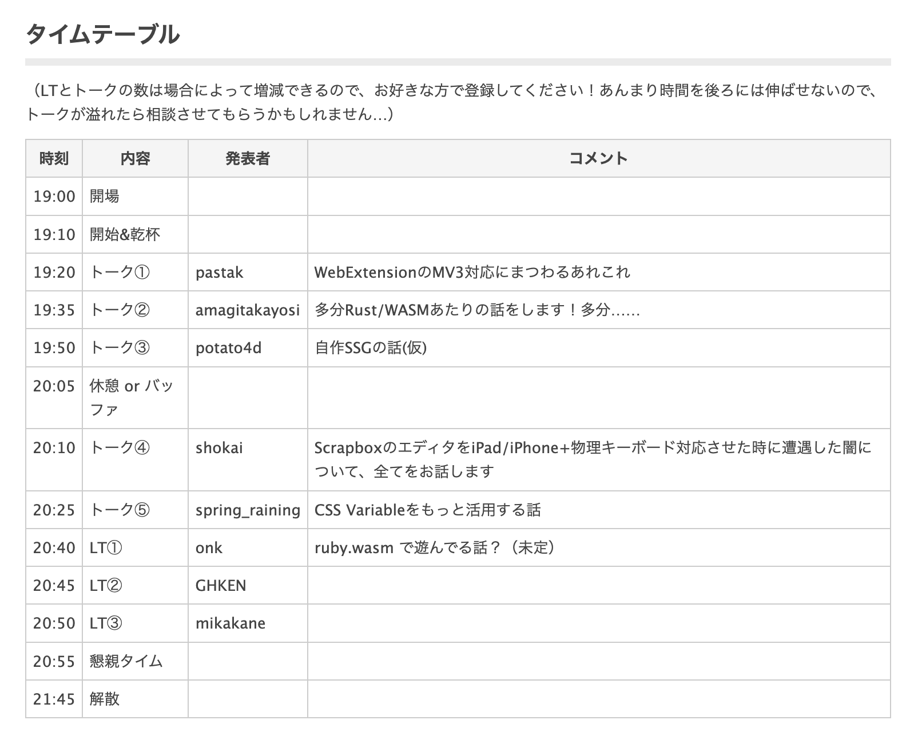

---

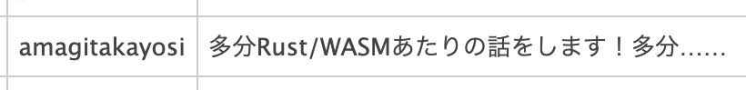

---


---

<h2 class="center">…………。。。</h2>

---

<!-- theme: red_black -->
<!-- transition: zoom -->
<!-- duration: 2 -->

<h1 class="center" style="font-size: 192px;">ごめんなさい<br/>！！！！！！！<br/>！！！！！！！</h1>

---

<!-- theme: yellow_black -->

<h1 class="center" style="font-size: 192px;">Kyoto.js<br/>引退します！！！！<br/>！！！！！！！！！<br/>！！！！！！！！！</h1>

---

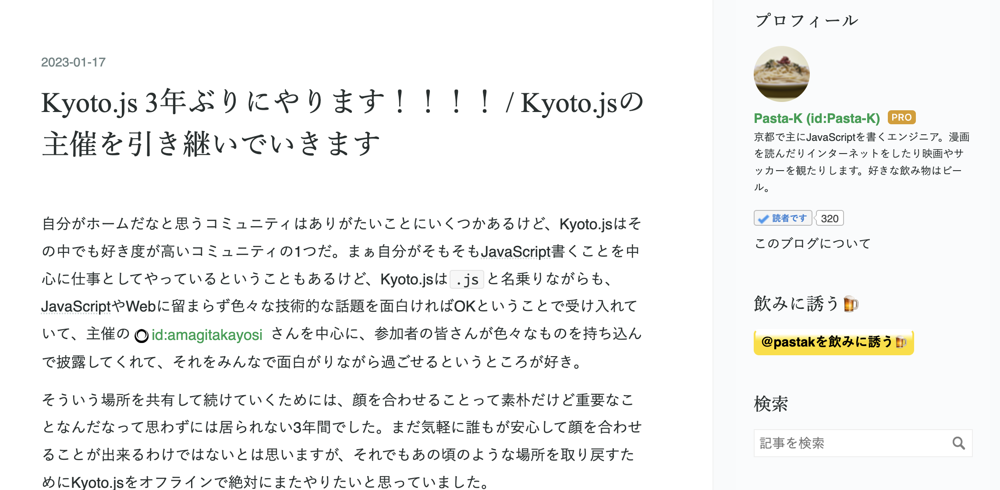

---

<!-- theme: yellow_black -->

<h1 class="center">引き続き Kyoto.js をよろしくお願いします！</h1>
