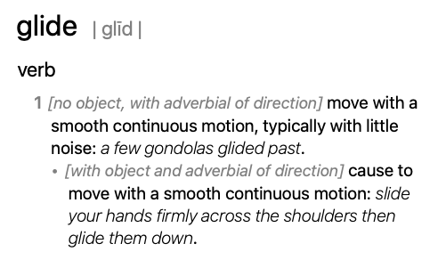

<!-- layout: center -->

# Every slide is HTML

So a slide can hold video, iframes, canvases and its own `

HIC ✅ in the GPU stage at the right size, transitions show it (vfx-js redraws nested canvases) · fallback ⚠️ plain DOM · --no-gpu ✅ · loop stops on unmount in all modes

---

## WebGL2

Tests: a raw WebGL2 shader on a <code>&lt;canvas&gt;</code>, drawn every frame; the context is released on unmount.

<canvas id="gl" width="640" height="360" style="width: 100%"></canvas>

HIC ✅ in the GPU stage at the right size, transitions show it · fallback ⚠️ plain DOM · --no-gpu ✅ · loop stops and context is released on unmount

---

## 2D canvas + pointer

Tests: a 2D canvas that follows the pointer. Clicking it must not turn the page.

<canvas id="trail" width="640" height="360" style="width: 100%; background: #11111b; border-radius: 8px"></canvas>

HIC ✅ drawn and follows the pointer (Chrome 156 without hit testing: ⚠️ drawn, but the pointer does not reach it) · fallback ⚠️ plain DOM · --no-gpu ✅ · clicks on the canvas do not turn the page

---

## Form controls

Tests: typing, a range slider and a button. Arrow keys and Space belong to the focused control; Esc gives them back to the deck.

  <label>Name <input id="name" value="glide" style="font-size: 0.8rem"/></label>
  <output id="hello" style="font-size: 0.9rem">Hello, glide!</output>

  <input id="size" type="range" min="20" max="300" value="80" style="width: 40%"/>
  

  <button id="count" style="font-size: 0.8rem">clicked 0 times</button>

HIC ✅ typing, slider drag and button work, keys stay in the control (Chrome 156 needs experimental web platform features for clicks; without them ⚠️ plain DOM) · fallback ⚠️ plain DOM · --no-gpu ✅

---

## CSS animation + hover

Tests: an infinite <code>@keyframes</code> animation, and a <code>:hover</code> style with a transition.

  

  
hover me

HIC ✅ animation and hover (Chrome 156 without hit testing: ⚠️ plain DOM) · fallback ⚠️ plain DOM · --no-gpu ✅

---

## SVG

Tests: SMIL <code>&lt;animate&gt;</code> (left) and a CSS-animated SVG shape (right).

<svg width="240" height="240" viewBox="0 0 120 120">
  <circle cx="60" cy="60" r="20" fill="#fab387">
    <animate attributeName="r" values="10;50;10" dur="2s" repeatCount="indefinite"/>
  </circle>
</svg>
<svg width="240" height="240" viewBox="0 0 120 120">
  <rect class="svg-rot" x="30" y="30" width="60" height="60" rx="8" fill="#94e2d5"/>
</svg>

HIC ✅ both move · fallback ⚠️ plain DOM (dom-to-canvas freezes SMIL) · --no-gpu ✅

---

## Audio

Tests: <code>&lt;audio controls&gt;</code> and a button that plays it from script. No pixels to capture, only controls.

  <audio id="beep" controls src="beep.m4a"></audio>
  <button id="play" style="font-size: 0.8rem">play from script</button>

HIC ✅ controls show, play from script works (Chrome 156 without hit testing: ⚠️ plain DOM) · fallback ⚠️ plain DOM · --no-gpu ✅

---

## Same-origin iframe

Tests: a local page in an <code>&lt;iframe&gt;</code> with its own CSS animation and a button.

<iframe class="center" src="demo2-frame.html" width="640" height="300" style="border: 0; border-radius: 8px"></iframe>

HIC ✅ captured with its animation; its button works (Chrome 156 without hit testing: ⚠️ plain DOM) · fallback ⚠️ plain DOM · --no-gpu ✅

---

## Details, links, selection

Tests: a <code>&lt;details&gt;</code> toggle, a link, and selecting text with the mouse.

Click to open

Hidden text, shown after the toggle.

A [link to glide](https://github.com/fand/glide) opens in this tab.

Drag across this sentence to select it.

HIC ✅ toggle, link and selection work · fallback ⚠️ plain DOM · --no-gpu ✅

---

## Scroll box

Tests: an element that scrolls inside the slide (wheel over it).

Line 1

Line 2

Line 3

Line 4

Line 5

Line 6

Line 7

Line 8

Line 9

Line 10

Line 11

Line 12

Line 13

Line 14

Line 15

Line 16

Line 17

Line 18

Line 19

Line 20 (the end)

HIC ✅ the box scrolls and re-captures · fallback ⚠️ plain DOM (dom-to-canvas loses the scroll position) · --no-gpu ✅

---

## Web Component

Tests: a custom element with shadow DOM that updates itself (a clock), defined once per page.

<glide-clock></glide-clock>

HIC ✅ the clock ticks · fallback ⚠️ plain DOM · --no-gpu ✅

---

## three.js 🌐

Tests: a <code>type="module"</code> script importing three.js from a CDN.

HIC ✅ in the GPU stage at the right size, transitions show it · fallback ⚠️ plain DOM · --no-gpu ✅ · loop and context released on unmount

---

## Summary

HIC with <code>--enable-blink-features=CanvasDrawElement</code>. Chrome 156 sends clicks into the GPU stage only with experimental web platform features ("+hit"); Chrome 159 does without. "plain" = shown as plain DOM above the GPU stage: works, but the transition into and out of it is a cut.

| Content | Chrome 159 | 156 +hit | 156 | fallback | --no-gpu |
| --- | --- | --- | --- | --- | --- |
| image | ✅ | ✅ | ✅ | ✅ | ✅ |
| video | ✅ | ✅ | ✅ | ⚠️ plain | ✅ |
| GIF | ✅ | ✅ | ✅ | ⚠️ plain | ✅ |
| YouTube 🌐 | ⚠️ plain | ⚠️ plain | ⚠️ plain | ⚠️ plain | ✅ |
| p5.js 🌐 | ✅ | ✅ | ✅ | ⚠️ plain | ✅ |
| WebGL2 | ✅ | ✅ | ✅ | ⚠️ plain | ✅ |
| 2D canvas + pointer | ✅ | ✅ | ⚠️ no pointer | ⚠️ plain | ✅ |
| form controls | ✅ | ✅ | ⚠️ plain | ⚠️ plain | ✅ |
| CSS animation + hover | ✅ | ✅ | ⚠️ plain | ⚠️ plain | ✅ |
| SVG (SMIL, CSS) | ✅ | ✅ | ✅ | ⚠️ plain | ✅ |
| audio | ✅ | ✅ | ⚠️ plain | ⚠️ plain | ✅ |
| same-origin iframe | ✅ | ✅ | ⚠️ plain | ⚠️ plain | ✅ |
| details, links, selection | ✅ | ✅ | ⚠️ plain | ⚠️ plain | ✅ |
| scroll box | ✅ | ✅ | ⚠️ plain | ⚠️ plain | ✅ |
| Web Component | ✅ | ✅ | ✅ | ⚠️ plain | ✅ |
| three.js 🌐 | ✅ | ✅ | ✅ | ⚠️ plain | ✅ |
